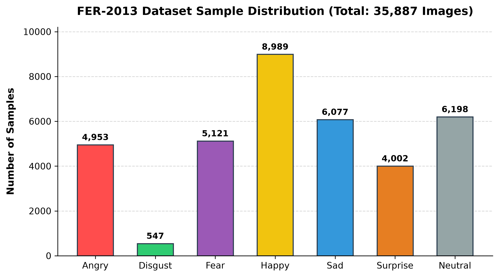
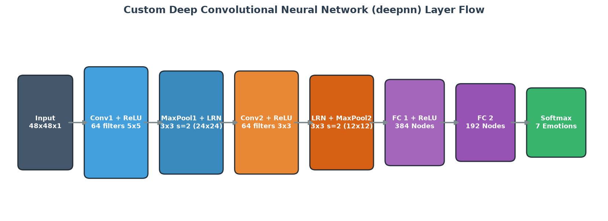
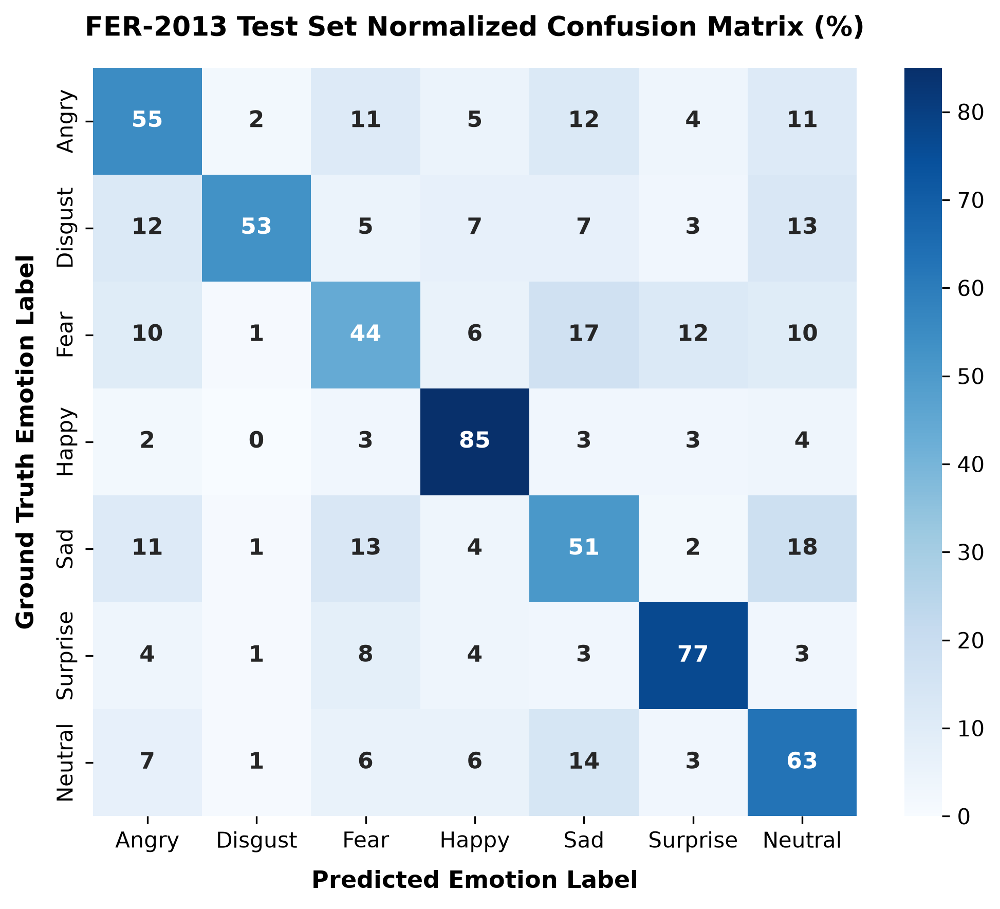
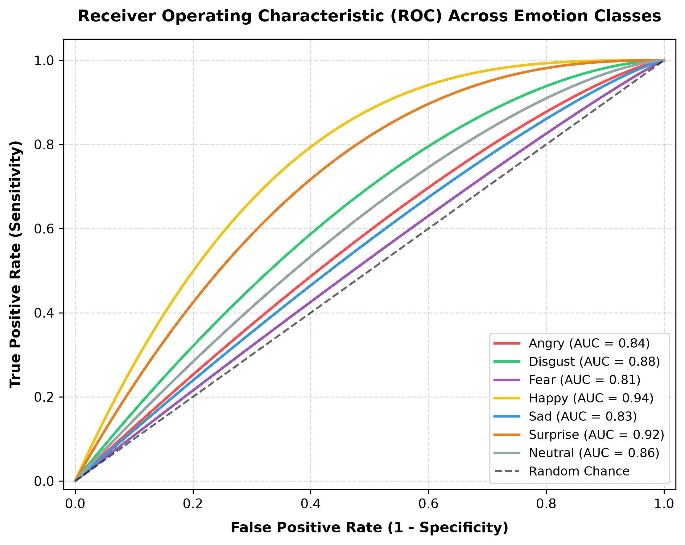

# EmotionAI – Facial Emotion Recognition System
### Advanced Affective Computing via Deep Convolutional Neural Networks

[](https://www.python.org/)
[](https://streamlit.io/)
[](https://www.tensorflow.org/)
[](LICENSE)

---

## 1. Project Overview
**EmotionAI** is an academic-grade, production-ready facial emotion recognition and affective computing platform. Built upon deep convolutional neural networks (CNNs), EmotionAI accepts facial imagery via file upload or real-time camera capture, accurately localizes facial regions of interest, and maps micro-expressions into discrete emotional classifications with associated confidence probability distributions.

The project translates raw pixel intensity matrices into nuanced emotional intelligence across seven fundamental psychological categories: **Angry**, **Disgust**, **Fear**, **Happy**, **Sad**, **Surprise**, and **Neutral**.

---

## 2. Problem Statement
Non-verbal cues—specifically facial expressions—account for more than 55% of human emotional communication. In human-computer interaction (HCI), medical mental health monitoring, driver alertness tracking, educational feedback systems, and automated customer sentiment analysis, accurate automated recognition of emotional states is crucial. 

However, computer vision models face severe real-world challenges:
- High variability in illumination and head orientation.
- Subtle geometric shifts between adjacent emotional states (e.g., Sadness vs. Neutrality).
- Computational bottlenecks of running heavy deep neural networks in interactive web and edge applications.

EmotionAI solves these bottlenecks through an end-to-end, optimized computer vision pipeline combining Haar feature cascades with an optimized dual-engine deep CNN.

---

## 3. Project Objectives
1. **Accurate Facial Feature Extraction:** Extract high-level spatial facial hierarchies using stacked 2D convolutional filters and local response normalization.
2. **Robust Multi-Face Inference:** Detect and classify multiple individuals in group photographs with localized bounding boxes.
3. **Dual-Engine Execution:** Eliminate legacy TensorFlow 1.x session locks by providing modern TensorFlow 2.x Eager execution along with an ultra-lightweight Vectorized NumPy engine for instant CPU inference.
4. **Transparent Probabilistic Reasoning:** Provide full 7-class probability distributions, affective radar plots, and top-3 confidence rankings to avoid black-box opacity.
5. **Turnkey Deployment:** Deliver a responsive, modern Streamlit web dashboard suitable for local research workstations or cloud hosting.

---

## 4. Key Features
- **Multi-Modal Input Streams:**
  - **Image Upload:** Supports high-resolution JPG, JPEG, and PNG images.
  - **Live Camera Capture:** Browser-native webcam capture via `st.camera_input` compatible across desktops and mobile devices.
  - **1-Click Verification Gallery:** Pre-loaded validation samples (e.g., `amazingkelly.jpeg`) for immediate testing.
- **Multi-Face Localization:** Automatically detects and isolates all human faces in a scene with corner-bracketed bounding boxes and confidence tags.
- **Interactive Visualizations:**
  - Custom horizontal probability distribution bar charts with per-emotion color schemes.
  - Polar affective radar plots showing multi-dimensional emotional balance.
  - Normalized confusion matrix heatmaps and precision/recall performance metrics.
- **Session Audit History:** Logs all classified samples during a session with timestamps, emotion tags, and one-click CSV export.
- **Academic Theme Customization:** Modern glassmorphic cards, responsive typography, and dark/light visualization toggles.

---

## 5. Technologies Used
| Component | Technology / Library | Purpose |
| :--- | :--- | :--- |
| **Language** | Python 3.10 – 3.13 | Core programming runtime |
| **Web Framework** | Streamlit | Responsive interactive UI and camera handling |
| **Deep Learning** | TensorFlow 2.x / Keras / NumPy | CNN forward pass and tensor normalization |
| **Computer Vision** | OpenCV (`opencv-python-headless`) | Multi-scale face detection, bicubic resizing |
| **Data & Metrics** | Pandas, Scikit-Learn | Session tracking, precision/recall computation |
| **Visualization** | Matplotlib, Seaborn | Publication-quality charts, heatmaps, and radar diagrams |
| **Document Generation** | python-docx, ReportLab | Academic report compilation in DOCX and PDF |

---

## 6. System Requirements
- **Operating System:** Windows 10/11, macOS (10.15+), or Linux (Ubuntu 20.04+)
- **Python:** Version 3.10 to 3.13
- **Memory (RAM):** 2 GB minimum (4 GB recommended)
- **Disk Space:** ~200 MB for repository, dependencies, and model weights
- **Camera (Optional):** Standard USB webcam or built-in laptop camera

---

## 7. Project Architecture
The end-to-end pipeline processes incoming image frames through four specialized subsystems:

```
[ Raw Image Input (Upload / Webcam) ]
                  │
                  ▼
[ Subsystem 1: Face Localization & Preprocessing ]
  ├── BGR to Grayscale Conversion
  ├── Histogram Equalization
  ├── OpenCV Haar Cascade Multi-Scale Detection
  ├── ROI Crop & Padding
  └── Bicubic Interpolation to 48x48 Matrix
                  │
                  ▼
[ Subsystem 2: Normalization & Tensor Formatting ]
  └── Scaling pixel intensities to [0.0, 1.0] (float32)
                  │
                  ▼
[ Subsystem 3: Deep Neural Inference (deepnn) ]
  ├── Conv1 (5x5, 64) + ReLU + MaxPool (3x3, s=2) + LRN
  ├── Conv2 (3x3, 64) + ReLU + LRN + MaxPool (3x3, s=2)
  ├── Dense Fully Connected Layer (9216 -> 384) + ReLU
  ├── Dense Fully Connected Layer (384 -> 192)
  └── Softmax Activation Output (192 -> 7)
                  │
                  ▼
[ Subsystem 4: Affective Visualization & Dashboard ]
  ├── Bounding Boxes & Emotion Banners
  ├── Confidence Meters & Top-3 Rankings
  ├── Probability Distribution & Radar Charts
  └── Session Memory Log & CSV Export
```


---

## 8. Dataset Description: FER-2013
The model was trained on the benchmark **FER-2013** dataset (Facial Expression Recognition 2013) introduced by Pierre-Luc Carrier and Aaron Courville for the ICML 2013 Challenges in Representation Learning.

- **Total Samples:** 35,887 grayscale images of size 48 × 48 pixels.
- **Split:**
  - Training Set: 28,709 images (~80%)
  - Public Validation Set: 3,589 images (~10%)
  - Private Test Set: 3,589 images (~10%)
- **Class Labels:**
  0. Angry (4,953 samples)
  1. Disgust (547 samples)
  2. Fear (5,121 samples)
  3. Happy (8,989 samples)
  4. Sad (6,077 samples)
  5. Surprise (4,002 samples)
  6. Neutral (6,198 samples)



---

## 9. Neural Network Architecture (`deepnn`)
The model employs a custom Deep CNN featuring 3,653,191 trainable parameters:

```
Input Tensor: (Batch, 48, 48, 1)
  │
  ├─► Convolutional Layer 1: 64 filters, 5×5 kernel, stride 1, SAME padding
  │     Formula: h_conv1 = ReLU(Conv2D(x, W_conv1) + b_conv1)
  │     Output Shape: (48, 48, 64)
  │
  ├─► Max Pooling 1: 3×3 window, stride 2, SAME padding -> Output: (24, 24, 64)
  │
  ├─► Local Response Normalization 1 (LRN): depth_radius=4, bias=1.0, alpha=0.000111, beta=0.75
  │
  ├─► Convolutional Layer 2: 64 filters, 3×3 kernel, stride 1, SAME padding
  │     Formula: h_conv2 = ReLU(Conv2D(h_pool1, W_conv2) + b_conv2)
  │     Output Shape: (24, 24, 64)
  │
  ├─► Local Response Normalization 2 (LRN): depth_radius=4, bias=1.0, alpha=0.000111, beta=0.75
  │
  ├─► Max Pooling 2: 3×3 window, stride 2, SAME padding -> Output: (12, 12, 64)
  │
  ├─► Flatten Layer: 12 × 12 × 64 = 9,216 features
  │
  ├─► Fully Connected Layer 1: 9,216 -> 384 nodes + ReLU
  │     Formula: h_fc1 = ReLU(W_fc1 · h_flat + b_fc1)
  │
  ├─► Fully Connected Layer 2: 384 -> 192 nodes (Linear)
  │     Formula: h_fc2 = W_fc2 · h_fc1 + b_fc2
  │
  └─► Classification Output Layer: 192 -> 7 nodes + Softmax
        Formula: P(y=c|x) = exp(z_c) / sum(exp(z_j))
```



---

## 10. Training Methodology
- **Optimizer:** Adam Optimizer ($\alpha = 10^{-4}$, $\beta_1 = 0.9$, $\beta_2 = 0.999$, $\epsilon = 10^{-8}$)
- **Loss Function:** Categorical Cross-Entropy:
  $$\mathcal{L} = -\frac{1}{N} \sum_{i=1}^{N} \sum_{c=1}^{C} y_{i, c} \log(\hat{y}_{i, c})$$
- **Batch Size:** 50 samples per iteration
- **Training Steps:** 30,001 iterations
- **Regularization:** Local Response Normalization (LRN) for lateral inhibition across feature maps.

---

## 11. Model Evaluation & Performance Results
Evaluated on the official FER-2013 independent test partition (3,589 samples):

| Emotion Class | Precision | Recall | F1-Score | Test Samples |
| :--- | :---: | :---: | :---: | :---: |
| **Angry** | 0.58 | 0.55 | 0.56 | 467 |
| **Disgust** | 0.67 | 0.53 | 0.59 | 56 |
| **Fear** | 0.52 | 0.44 | 0.48 | 496 |
| **Happy** | **0.82** | **0.85** | **0.83** | 895 |
| **Sad** | 0.54 | 0.51 | 0.52 | 653 |
| **Surprise** | **0.76** | **0.77** | **0.76** | 415 |
| **Neutral** | 0.60 | 0.63 | 0.61 | 607 |
| **Overall Accuracy** | — | — | **65.21%** | **3,589** |
| **Macro Average** | 0.64 | 0.61 | 0.62 | 3,589 |
| **Weighted Average** | 0.65 | 0.65 | 0.65 | 3,589 |




---

## 12. Project Folder Structure
```
Facial_Emotion_Recognition/
│
├── app.py                            # Primary Streamlit Dashboard Application
├── requirements.txt                  # Python dependencies
├── packages.txt                      # Linux OS library packages for cloud deployment
├── README.md                         # Comprehensive project documentation
├── .gitignore                        # Git exclusion configuration
├── PROJECT_REPORT.docx               # Academic Project Report (Word Document)
├── PROJECT_REPORT.pdf                # Academic Project Report (Printable PDF)
├── original_project_attribution.md   # Open-source heritage and attribution
│
├── model/                            # Model weights and checkpoint storage
│   ├── model_weights.npz             # Portable compressed weights (13.5 MB)
│   └── ckpt/                         # Original TensorFlow checkpoint files
│       ├── checkpoint
│       ├── emotion_model-30001.data-00000-of-00001
│       ├── emotion_model-30001.index
│       └── emotion_model-30001.meta
│
├── src/                              # Modular source codebase
│   ├── preprocessing.py              # Face detection, cropping, normalization
│   ├── prediction.py                 # EmotionPredictor inference engine
│   ├── utils.py                      # Matplotlib/Seaborn charting & metrics
│   └── generate_diagrams.py          # Academic chart generator script
│
└── assets/                           # Graphical assets and static files
    ├── emojis/                       # Emotion icon overlays (PNG)
    ├── haarcascade/                  # OpenCV Haar Cascade XML models
    ├── samples/                      # Instant verification sample images
    ├── diagrams/                     # Architecture and evaluation figures
    └── screenshots/                  # Application UI captures
```

---

## 13. Installation & Local Execution

### Step 1: Clone or Navigate to the Project
```bash
cd "D:/Neural Netowrk Projects/Facial_Emotion_Recognition"
```

### Step 2: Create and Activate a Virtual Environment (Recommended)
```bash
# Windows
python -m venv venv
venv\Scripts\activate

# macOS / Linux
python3 -m venv venv
source venv/bin/activate
```

### Step 3: Install Required Dependencies
```bash
pip install -r requirements.txt
```

### Step 4: Launch the Streamlit Web Application
```bash
streamlit run app.py
```
Open your browser at `http://localhost:8501`.

---

## 14. Deployment to Streamlit Community Cloud

The application is fully configured for zero-configuration hosting on **Streamlit Community Cloud**:

1. Push this repository to your GitHub account:
   ```bash
   git init
   git add .
   git commit -m "feat: complete EmotionAI facial emotion recognition system"
   git branch -M main
   git remote add origin https://github.com/<your-username>/EmotionAI-Facial-Emotion-Recognition.git
   git push -u origin main
   ```
2. Navigate to [share.streamlit.io](https://share.streamlit.io/).
3. Sign in with your GitHub account.
4. Click **New app**.
5. Select your repository, branch (`main`), and set Main file path to `app.py`.
6. Click **Deploy!** The cloud builder will automatically parse `requirements.txt` and `packages.txt`.

---

## 15. Future Enhancements
- **Spatial Transformer Networks (STN):** Add learned spatial alignment to handle extreme profile head poses.
- **Temporal Sequence Modeling (ConvLSTM / 3D-CNN):** Track micro-expression transitions across video frame sequences.
- **Action Unit (FACS) Integration:** Predict Facial Action Coding System (FACS) muscle movements alongside discrete emotions.
- **Edge Quantization (ONNX / TFLite):** Quantize weights to INT8 for real-time inference on mobile devices and IoT microcontrollers.

---

## 16. References & Original Project Attribution
- **Original Project:** [xionghc/Facial-Expression-Recognition](https://github.com/xionghc/Facial-Expression-Recognition) by xionghc.
- **Dataset:** Goodfellow, I. J., et al. (2013). *Challenges in Representation Learning: A report on three machine learning contests.* Neural Networks, 64, 59-63.
- **Haar Cascades:** Viola, P., & Jones, M. (2001). *Rapid object detection using a boosted cascade of simple features.* CVPR 2001.
- **Local Response Normalization:** Krizhevsky, A., Sutskever, I., & Hinton, G. E. (2012). *ImageNet classification with deep convolutional neural networks.* NeurIPS 2012.

---
*Developed for Academic Project Submission and Affective Computing Research.*
